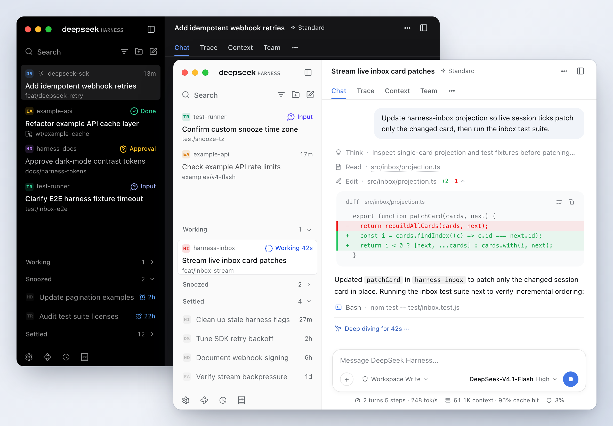

# dsh-t3-inbox

An attention-first, T3 Code–inspired inbox sidebar for **DeepSeek Harness**.

English | [简体中文](README.zh.md)

[](LICENSE)
[](package.json)
[](package.json)

> **Disclaimer:** Design and interaction are inspired by [T3 Code](https://github.com/pingdotgg/t3code). This is an independent community plugin and is **not** affiliated with Ping Labs or DeepSeek.



## Why T3 Inbox?

When you run multiple agents across several repositories, chronological session lists quickly turn noisy: active completions, pending approvals, background runs, and old threads all look alike.

**T3 Inbox** turns the DeepSeek Harness sidebar into an attention queue—derived safely from your session event logs without altering your underlying conversations—and lets you switch back to the native **Workspaces View** anytime in one click.

## Features

- **Attention Shelves, Not Destructive Deletes**
  - Organizes sessions into **Pinned**, **Active** (`Approval`, `Input`, `Failed`, `Limited`, `Woke`, `Done`), **Working** (optional collapsible shelf with live timers), **Snoozed** (`36px` compact rows showing remaining wake time), and bottom-anchored **Settled** (`10 + 25` pagination).
  - **Settle** and **Snooze** only update lightweight plugin attention metadata—never archiving a session, stopping a running turn, answering prompts, or canceling queued work.
  - Subagent / tree awareness aggregates verified local children into their root card, including `Waiting` subagent indicators.
- **Fast, Durable & Reversible Interactions**
  - **O(1) incremental Host refreshes** paired with **optimistic Client updates** and automatic rollback on failure.
  - **5-second conditional Undo (`⌘Z` / `Ctrl+Z`)** in the footer bar for Settle, Snooze, and direct Unpin, backed by revision checks and idempotent operation IDs.
  - Viewing a session marks unseen completions as seen automatically; **Mark unread** lets you bring a thread back to attention anytime.
- **Flexible Snoozing**
  - Up to **8 editable Snooze shortcuts** (`minutes`, `hours`, `days`, or specific weekday clocks) plus a per-thread **Custom snooze** modal with a keyboard-accessible **Date and time** calendar picker and **Duration** stepper.
  - Ordinary questions with valid Host request identity can be deferred cleanly until wake; approvals and newly arrived prompts surface immediately so critical work is never hidden.
- **Ranked Search, Project Filter & Git Context**
  - Combobox search ranking across thread titles, Git branches, project names, short IDs, and debounced session message excerpts (`<mark>` highlights).
  - Multi-select **Project filter** (`Shift+Click`) with colored 18-hue SVG monograms and corner checkmarks.
  - Git branch & **Git worktree** indicators plus model metadata in hover preview cards.
- **Keyboard, Drag & Batch Workflows**
  - **Hold `⌘` / `Ctrl`** (Desktop) to reveal `1–9` jump badges; **press & sweep** vertically to batch-settle, wake, or un-settle; **`⌘+Click` / `⇧+Click`** multi-select with batch context menus; **pointer drag-and-drop** between `Pinned`, `Active`, and `Settled`; **`F2` or double-click** inline rename.
- **Clean Chrome Integration & 8 Languages**
  - Fits flush into the wide sidebar with bottom-left **Global panels** icons (next to Settings, overflowing into a `More` menu beyond 3 panels), three **Background** modes (`Follow DSH theme`, `T3 colors`, `Custom`), and full localization in **English, 简体中文, 日本語, Español, Français, Deutsch, Русский, and Português**.

## Installation

### Option 1: Via Plugin Manager / Market (Recommended)

Search for **`dsh-t3-inbox`** in `dshmarket` or the Harness **Plugins → Discover** tab, install it, and restart DeepSeek Harness when prompted.

### Option 2: Via CLI

```sh
dsh plugin add dsh-t3-inbox
```

If you target a non-default profile:

```sh
dsh plugin --profile <profile> add dsh-t3-inbox
```

Restart DeepSeek Harness after installation.

> **Non-invasive & Reversible:** You can switch seamlessly between **Inbox View** and native **Workspaces View** from **Settings → T3 Inbox** (or from the view switch icon when Global panels are in the top strip / overflow menu) without losing any sessions or saved preferences.

## Keyboard Shortcuts

| Action | macOS | Windows / Linux | Notes |
| --- | --- | --- | --- |
| Previous / Next thread | `⌘⇧[` / `⌘⇧]` | `Ctrl+Shift+[` / `Ctrl+Shift+]` | Traverses visible active order |
| Settle / Un-settle thread | `⌘⇧S` | `Ctrl+Shift+S` | Operates on current thread |
| Pin / Unpin thread | `⌘⇧P` | `Ctrl+Shift+P` | Promoted/demoted cleanly |
| Jump to thread 1–9 | `⌘1` – `⌘9` | `Ctrl+1` – `Ctrl+9` | Desktop; hold `⌘`/`Ctrl` 200ms to preview |
| Undo Settle / Snooze / Unpin | `⌘Z` | `Ctrl+Z` | Active for 5s while Undo bar is shown |
| Inline rename thread | `F2` / Double-click | `F2` / Double-click | Press `Enter` to save, `Esc` to cancel |
| Batch select cards / projects | `⌘+Click` / `⇧+Click` | `Ctrl+Click` / `Shift+Click` | Range or toggle selection |
| Navigate & clear search/menus | `↑` `↓` `←` `→` `Esc` | `↑` `↓` `←` `→` `Esc` | Full ARIA keyboard support |

## Settings (`Settings → T3 Inbox`)

Open **Settings** from the gear button at the lower left of Inbox View, then choose **T3 Inbox**:

- **Sidebar view**: Switch between **Inbox View** and native **Workspaces View** at any time.
- **Appearance & layout** *(shown in Inbox View)*:
  - **Background**: `Follow DSH theme (Default)`, `T3 colors` (`#fafafa` / `#000000`), or `Custom` light/dark color pickers.
  - **Global panels**: Choose `Footer (Default)` (next to Settings, up to 3 icons + More menu), `Top`, or `Hidden`.
- **Inbox behavior** *(shown in Inbox View)*:
  - **Working section**: Fold running/waiting threads into a collapsible **Working** shelf (turns back to Active once an unread completion arrives).
  - **Snooze shortcuts**: Add, edit, reorder, or reset up to 8 quick-snooze presets with live wake-time previews.
  - **Time format**: `System default`, `12-hour`, or `24-hour` for Snooze menu wake times.

All preferences persist across restarts per profile.

## Compatibility & Known Limitations

- **Host requirement**: `dsh >= 0.2.2-rc.1` (developed and verified against DeepSeek Harness `0.2.2-rc.3`).
- **Sidebar shell CSS coupling**: Seamless wide-mode shell styling targets the current `@deepseek-ai/dsh-client-ui-sidebar` layout classes (`kB3qhq_*`). Major upstream host sidebar redesigns may require plugin updates; switching to **Workspaces View** always restores the unmodified native UI.
- **Scope notes**:
  - `capabilities.awaitedWork` is `false`; live running status uses native Host runtime/queue signals.
  - Large-scale `1000`-root / `200`-member projections are verified via synthetic benchmarks rather than production telemetry.

## Development

```sh
git clone https://github.com/tungloong/dsh-t3-inbox.git
cd dsh-t3-inbox
npm install --ignore-scripts
npm test
npm run check
npm audit --omit=dev
```

### Architecture

- `index.js`: Host service (`T3InboxService`), progress projection, bounded child-tree aggregation (`concurrency = 2`), persistent attention domain, HMAC-signed `writeContext`, CAS actions, and conditional Undo.
- `lib/model.js`: Pure progress fold, attention state classification, return sorting, ranked search, drag projection, and candidate selection.
- `lib/snooze-presets.js`: Strict preset validation, weekday/DST calculation, and custom duration/date resolution.
- `lib/schemas.js`: Strict Zod persistence and Typert wire schemas.
- `lib/git-branch.js`: Repository branch and Git worktree detection.
- `typert.js`: Strict Typert Host contribution (`unary` + `stream`).
- `client.js`: Browser Remote mount, stream lifecycle, sidebar React UI, native context menus, keyboard shortcuts, tooltips, and Settings integration.
- `locale/*.json`: Localized manifest metadata across 8 languages.
- `test/`: Unit, protocol, DOM/React (`jsdom`, strict `512MB` heap cap), and concurrency tests (`154` tests total).

## Acknowledgments

- Inspired by the sidebar design and attention-inbox workflow of [T3 Code](https://github.com/pingdotgg/t3code).
- Built for [DeepSeek Harness](https://github.com/deepseek-ai).

## License

[MIT](LICENSE) © 2026 [tungloong](https://github.com/tungloong)
