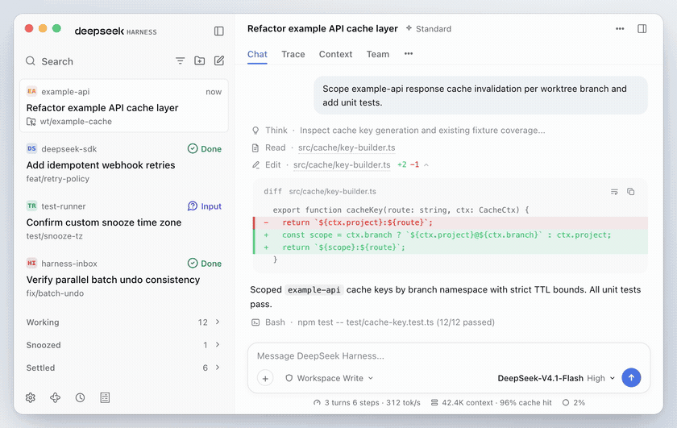

# dsh-t3-inbox

An attention-first, T3 Code–inspired inbox sidebar for [**DeepSeek Harness**](https://github.com/deepseek-ai/deepseek-harness) — stop babysitting running agents and focus only on what needs your decision right now.

English | [简体中文](README.zh.md)

[](LICENSE)
[](package.json)
[](package.json)

> **Disclaimer:** Visual design and attention-inbox workflow are inspired by [T3 Code](https://github.com/pingdotgg/t3code). This is an independent community plugin and is **not** affiliated with Ping Labs or DeepSeek.


## Why dsh-t3-inbox?

When you run 10+ coding agent sessions across repositories, chronological sidebars and folder trees turn into noise. You end up burning attention on two things: compulsively checking threads that are still working, and hunting for which chat is stuck waiting on a "Yes".

**dsh-t3-inbox** reorganizes your DeepSeek Harness sidebar around **human attention** instead of chronology:

- **Separate running work from what needs you:** In-progress threads sit apart in a quieter **Working** section below (collapsible anytime) instead of cluttering your queue, then surface back to the inbox the moment they finish or need input.
- **Status and context right on the card:** Every card shows explicit status text (`Approval`, `Input`, `Failed`, `Limited`, `Woke`, `Done`), a colored project monogram, and its Git branch / worktree context so you can see who is waiting at a glance.
- **Keep the queue clean with Settle and Snooze:** Click **Settle** to move finished threads to the bottom shelf without deleting them, or **Snooze** anything that can wait until later — keeping only what needs action right now in your inbox.

## In Action

Click to **Settle** one thread, hold and **sweep** vertically to clear the rest, press **`⌘Z`** to bring everything back in one frame, or **Snooze** a thread for later:



## Features

- **Attention Shelves: Pinned, Active & Working Flow**
  - Automatically routes threads across **Pinned**, **Active**, and a dedicated **Working** section (muted visual weight, live elapsed timers, collapsible anytime) — keeping running tasks cleanly separated from what needs your decision, then rising back to the top when done, complete with subagent tree aggregation and `Waiting` status indicators.
  - Every card surfaces explicit status text (`Approval`, `Input`, `Failed`, `Limited`, `Woke`, `Done`), a colored project monogram, and **Git branch & worktree** indicators, plus hover preview cards with full title, project, branch, and current model.
- **Settle Instead of Archive**
  - **Settle** moves finished threads to a quiet bottom-anchored **Settled** shelf (`10 + 25` pagination) instead of hiding them away — your inbox stays calm while every thread remains one click away.
  - Press and **sweep vertically** across Settle, Wake, or Un-settle buttons to process a whole batch at once, backed by a **5-second `⌘Z` / `Ctrl+Z` Undo bar**.
  - Viewing a session clears its unread `Done` marker automatically; **Mark unread** brings any thread back to attention anytime.
- **Snooze for Mental Overload & Deferred Follow-Ups**
  - Not done yet, just not right now? Move low-urgency threads to compact `36px` **Snoozed** rows with live wake countdowns so they stop cluttering your active queue.
  - Customize up to **8 quick-snooze presets** (`minutes`, `hours`, `days`, or specific weekday clocks) or open the **Custom snooze** modal with a keyboard-accessible calendar and duration picker.
  - Urgent **Approvals** and newly arrived prompts still surface immediately so critical work is never missed.
- **Ranked Search, Project Filter, Keyboard & Drag**
  - **Ranked search** across titles, Git branches, project names, short IDs, and debounced message excerpts (`<mark>` highlights), paired with a multi-select **Project filter** (`Shift+Click`).
  - **Hold `⌘` / `Ctrl`** (Desktop) to reveal `1–9` jump badges; **`⌘+Click` / `⇧+Click`** multi-select with batch context menus; **drag-and-drop** across `Pinned`, `Active`, and `Settled`; **`F2` or double-click** inline rename.
- **Zero-Risk Integration, Auto Theme Detection & 8 Languages**
  - Stores only lightweight plugin attention metadata — never modifies session logs, archives conversations, stops running turns, answers prompts, or cancels queued work.
  - **1-click escape hatch:** Switch back to the native **Workspaces View** anytime in **Settings → Inbox** with all sessions and preferences intact.
  - **Auto background** applies T3 colors on the native DSH theme and automatically follows third-party skins; bottom-left **Global panels** keep the chrome flush; localized in **English, 简体中文, 日本語, Español, Français, Deutsch, Русский, and Português**.

## Installation

### Option 1: Via Plugin Manager / Market (Recommended)

Search for **`dsh-t3-inbox`** in `dshmarket` or the Harness **Plugins → Discover** tab, install it, and restart DeepSeek Harness when prompted.

### Option 2: Via CLI

```sh
dsh plugin add dsh-t3-inbox
```

For a specific profile:

```sh
dsh plugin --profile <profile> add dsh-t3-inbox
```

Restart DeepSeek Harness after installation.

> **Non-invasive & Reversible:** Prefer the original layout? Flip back to native **Workspaces View** anytime from **Settings → Inbox** (or via the view-switch icon when Global panels are placed at the top) without losing any sessions or settings.

## Keyboard Shortcuts

| Action | macOS | Windows / Linux | Notes |
| --- | --- | --- | --- |
| Previous / Next thread | `⌘⇧[` / `⌘⇧]` | `Ctrl+Shift+[` / `Ctrl+Shift+]` | Traverses visible active order |
| Settle / Un-settle thread | `⌘⇧S` | `Ctrl+Shift+S` | Operates on current thread |
| Pin / Unpin thread | `⌘⇧P` | `Ctrl+Shift+P` | Promoted/demoted cleanly |
| Jump to thread 1–9 | `⌘1` – `⌘9` | `Ctrl+1` – `Ctrl+9` | Desktop; hold `⌘`/`Ctrl` 200ms to preview |
| Undo Settle / Snooze / Unpin | `⌘Z` | `Ctrl+Z` | Active for 5s while Undo bar is shown |
| Inline rename thread | `F2` / Double-click | `F2` / Double-click | Press `Enter` to save, `Esc` to cancel |
| Batch select cards / projects | `⌘+Click` / `⇧+Click` | `Ctrl+Click` / `Shift+Click` | Range or toggle selection |
| Navigate & clear search/menus | `↑` `↓` `←` `→` `Esc` | `↑` `↓` `←` `→` `Esc` | Full ARIA keyboard support |

## Settings (`Settings → Inbox`)

Open **Settings** from the gear button at the lower left of Inbox View, then choose **Inbox**:

- **Sidebar view**: Switch between **Inbox View** and native **Workspaces View** at any time.
- **Appearance & layout** *(shown in Inbox View)*:
  - **Background**: `Auto (default)` (T3 `#fafafa` / `#000000` on the native DSH theme, automatically following third-party skins), `T3 colors`, `DSH theme`, or `Custom` light/dark color pickers.
  - **Global panels**: Choose `Footer (Default)` (next to Settings, up to 3 icons + More menu), `Top`, or `Hidden`.
- **Inbox behavior** *(shown in Inbox View)*:
  - **Working section**: Fold running/waiting threads into a collapsible **Working** shelf (returns to Active automatically when an unread completion arrives).
  - **Snooze shortcuts**: Add, edit, reorder, or reset up to 8 quick-snooze presets with live wake-time previews.
  - **Time format**: `System default`, `12-hour`, or `24-hour` for Snooze menu wake times.

All preferences persist locally per profile across restarts.

## Compatibility & Known Limitations

- **Host requirement**: `dsh >= 0.2.2-rc.1` (verified on DeepSeek Harness `0.2.2-rc.5` and configured for `0.2.x` prerelease ranges).
- **Sidebar shell CSS coupling**: Seamless wide-mode shell styling targets the current `@deepseek-ai/dsh-client-ui-sidebar` layout classes (`kB3qhq_*`). Major upstream host sidebar redesigns may require plugin updates; switching to **Workspaces View** always restores the unmodified native UI.
- **Scope notes**:
  - `capabilities.awaitedWork` is `false`; live running status uses native Host runtime/queue signals.
  - Large-scale `1000`-root / `200`-member projections are verified via synthetic benchmarks rather than production telemetry.

## Development & Architecture

```sh
git clone https://github.com/tungloong/dsh-t3-inbox.git
cd dsh-t3-inbox
npm install --ignore-scripts
npm test
npm run check
npm audit --omit=dev
```

### Architecture & Reliability

Built for responsiveness and state safety under concurrent sessions: **O(1) incremental Host refreshes**, **optimistic Client updates with automatic failure rollback**, **HMAC-signed `writeContext` tokens**, **revision CAS + idempotent operation IDs**, and **order-preserving batch mutations**.

- `index.js`: Host service (`T3InboxService`), progress projection, bounded child-tree aggregation (`concurrency = 2`), persistent attention domain, HMAC-signed `writeContext`, CAS actions, and conditional Undo.
- `lib/model.js`: Pure progress fold, attention state classification, return sorting, ranked search, drag projection, and candidate selection.
- `lib/snooze-presets.js`: Strict preset validation, weekday/DST calculation, and custom duration/date resolution.
- `lib/schemas.js`: Strict Zod persistence and Typert wire schemas.
- `lib/git-branch.js`: Repository branch and Git worktree detection.
- `typert.js`: Strict Typert Host contribution (`unary` + `stream`).
- `client.js`: Browser Remote mount, stream lifecycle, sidebar React UI, native context menus, keyboard shortcuts, tooltips, and Settings integration.
- `locale/*.json`: Localized manifest metadata across 8 languages.
- `test/`: Unit, protocol, DOM/React (`jsdom`, strict `512MB` heap cap), and concurrency tests (`160` tests total).

## Related Projects

- [T3 Code](https://github.com/pingdotgg/t3code) — inspiration for the sidebar visual design and attention-inbox workflow.
- [DeepSeek Harness](https://github.com/deepseek-ai/deepseek-harness) — the host application and plugin ecosystem this plugin is built for.

## License

[MIT](LICENSE) © 2026 [tungloong](https://github.com/tungloong)
