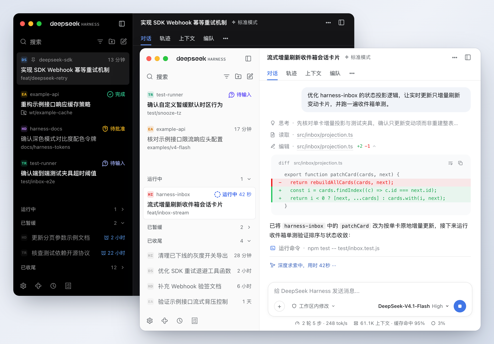
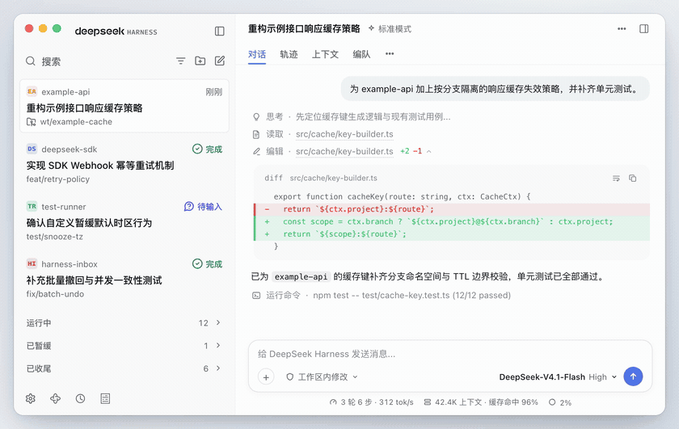

# dsh-t3-inbox

面向 [**DeepSeek Harness**](https://github.com/deepseek-ai/deepseek-harness) 的 T3 Code 风格注意力收件箱侧边栏插件 —— 告别盯着十几个 Agent 转圈的监工焦虑，只看此刻需要你拍板的事。

[English](README.md) | 简体中文

[](LICENSE)
[](package.json)
[](package.json)

> **声明：** 视觉与注意力收件箱体验灵感来源于开源项目 [T3 Code](https://github.com/pingdotgg/t3code)。本项目为独立社区插件，与 Ping Labs 或 DeepSeek 官方均无从属关系。



## 为什么做 DSH-T3-Inbox？

当你在多个仓库里同时跑着十几个 Agent 会话时，按时间线平铺或按项目折叠的传统侧边栏很快就会变成噪音。精力大多消耗在两件事上：忍不住反复点开正在运行的任务“监工”，以及在一堆标题里翻找“到底哪一个卡在等我点确认”。

**dsh-t3-inbox** 把侧边栏的组织方式从「按时间 / 项目归档」切换为围绕 **人的注意力**：

- **把「运行中」与「待处理」隔开**：正在后台干活的会话独立退居下方低干扰的 **运行中（Working）** 分区（需要时也可手动折叠），不再和待你拍板的会话混在一起；跑完或卡在确认点时自动浮回收件箱。
- **状态与上下文直接写在卡片上**：每张卡片直接显示具体状态（`待批准`、`待输入`、`失败`、`已达上限`、`已唤醒`、`完成`）、18 色项目徽章与 Git 分支 / worktree 信息，扫一眼就知道谁在等你。
- **用收尾和暂缓保持列表干净**：处理完的会话点一下 **收尾（Settle）** 收到底部折叠区，暂时不急的 **暂缓（Snooze）** 到稍后再提醒，只把当下要处理的留在收件箱里。

## 交互演示

单击 **收尾（Settle）** 处理单条，按住按钮竖向一划（**Sweep**）批量清零，按 **`⌘Z`** 一帧全回，不急的顺手 **暂缓（Snooze）**：



## 核心特性

- **注意力分区：置顶、收件箱与运行中自动流转**
  - 会话围绕注意力自动归类为 **置顶（Pinned）**、**收件箱（Active）** 与 **运行中（Working）**（独立分区、低视觉干扰、带实时秒级耗时且支持折叠）——需要你决策的留在眼前，正在后台跑任务的清晰隔开，完成后自动回到收件箱顶部；并支持子智能体树结果聚合与 `等待中（Waiting）` 状态提示。
  - 每张卡片直接呈现清晰状态文字（`待批准`、`待输入`、`失败`、`已达上限`、`已唤醒`、`完成`）、18 色项目徽章、Git 分支与 **worktree** 专属图标；行悬停预览浮卡显示完整标题、项目、分支与当前模型名称。
- **用收尾（Settle）代替归档（Archive）**
  - **收尾**不会把会话删掉或藏到找不到的角落，而是以低存在感折叠在侧栏底部 **已收尾（Settled）** 分区（`10 + 25` 渐进分页）——视野瞬间清净，上下文依然伸手可及。
  - 支持同分区 **按住按钮竖向扫选（Sweep）** 一次性批量收尾 / 唤醒 / 取消收尾，配合底部 **5 秒 `⌘Z` / `Ctrl+Z` 撤销条**，操作毫无心理负担。
  - 打开或阅读当前会话时自动消除未读 `完成` 标记；右键菜单随时可 **标记未读** 重新拉回收件箱。
- **暂缓（Snooze）：承接脑力过载与延迟跟进**
  - 还没做完但此刻没精力看，或者几小时后再收？一键移入 `36px` 紧凑 **已暂缓（Snoozed）** 分区并显示唤醒倒计时，把收件箱留给真正紧迫的事。
  - 可在设置中增删改排序多达 **8 个暂缓快捷选项**（支持分钟/小时/天与每周固定时刻），也可打开 **自定义暂缓** 弹窗使用 7 列月历选择器或时长步进器。
  - 关键的 **待批准（Approval）** 与新到达的交互仍会即时浮出，不会错过重要卡点。
- **高相关搜索、多选筛选与键盘拖拽**
  - **高相关搜索** 覆盖标题、Git 分支、项目名、短 ID 与防抖后的消息摘要高亮；**项目筛选器** 支持 `Shift+Click` 多选过滤。
  - 桌面端按住 **`⌘` / `Ctrl`** 显示 `1–9` 跳转角标；**`⌘+Click` / `⇧+Click`** 多选触发批量右键菜单；支持跨 `Pinned` / `Active` / `Settled` **指针拖拽重排**；`F2` 或双击标题即可 **内联重命名**。
- **零侵入退路、自动皮肤适配与 8 种语言**
  - 仅写入插件自身的轻量注意力元数据——绝不修改底层会话日志、不归档会话、不中断运行、不代答询问或清空队列。
  - **一键切回原生**：随时在 **设置 → 收件箱** 切回宿主原生 **工作区视图（Workspaces View）**，所有会话与偏好完整保留。
  - **自动侧栏背景** 在原生 DSH 主题下默认采用 T3 配色，检测到第三方皮肤插件时自动跟随让位；底栏紧凑收纳全局面板图标；完整内置 **简体中文、English、日本語、Español、Français、Deutsch、Русский、Português** 8 种语言。

## 安装方法

### 方式一：通过插件市场安装（推荐）

在 `dshmarket` 或 DeepSeek Harness 应用内的 **插件 → 发现（Discover）** 页面搜索 **`dsh-t3-inbox`** 点击安装，随后按提示重启应用即可。

### 方式二：通过命令行安装

```sh
dsh plugin add dsh-t3-inbox
```

如需安装到指定 profile：

```sh
dsh plugin --profile <profile> add dsh-t3-inbox
```

安装完成后重启 DeepSeek Harness 即可生效。

> **无侵入、随时可回退：** 更习惯原有布局？随时可在 **设置 → 收件箱** 中把「侧栏视图」切回原生 **工作区视图（Workspaces View）**，所有会话和插件配置都会完整保留。

## 快捷键速查

| 功能 | macOS | Windows / Linux | 说明 |
| --- | --- | --- | --- |
| 上一个 / 下一个会话 | `⌘⇧[` / `⌘⇧]` | `Ctrl+Shift+[` / `Ctrl+Shift+]` | 按侧栏可见顺序切换 |
| 收尾 / 取消收尾当前会话 | `⌘⇧S` | `Ctrl+Shift+S` | 作用于当前打开会话 |
| 置顶 / 取消置顶当前会话 | `⌘⇧P` | `Ctrl+Shift+P` | 置顶会同步更新有序列表 |
| 快速跳转前 1–9 个会话 | `⌘1` – `⌘9` | `Ctrl+1` – `Ctrl+9` | 桌面端；长按 `⌘`/`Ctrl` 200ms 显示角标 |
| 撤销最近操作（5 秒内） | `⌘Z` | `Ctrl+Z` | 支持撤销收尾、暂缓及直接取消置顶 |
| 内联重命名会话标题 | `F2` / 双击 | `F2` / 双击 | `Enter` 保存，`Esc` 取消 |
| 多选会话 / 多选项目筛选 | `⌘+Click` / `⇧+Click` | `Ctrl+Click` / `Shift+Click` | 配合批量右键菜单使用 |
| 键盘遍历与关闭弹层 | `↑` `↓` `←` `→` `Esc` | `↑` `↓` `←` `→` `Esc` | 覆盖列表、搜索、项目筛选与暂缓菜单 |

## 设置项说明（`设置 → 收件箱`）

点击收件箱视图左下角的齿轮图标打开 **设置**，选择左侧 **收件箱**：

- **侧栏视图**：随时切换 **收件箱视图（Inbox View）** 或宿主原生 **工作区视图（Workspaces View）**。
- **外观与布局**（在收件箱视图下显示）：
  - **背景**：可选 `自动（默认）`（原生 DSH 主题下采用 T3 `#fafafa` / `#000000` 配色，检测到第三方皮肤插件时自动跟随宿主）、`T3 配色`、`跟随 DSH 主题` 或 `自定义颜色` 浅深双色。
  - **全局面板**：可选 `底栏（默认）`（置入左下角设置旁，最多平铺 3 个并折叠多余面板）、`顶部` 或 `隐藏`。
- **收件箱行为**（在收件箱视图下显示）：
  - **运行中分组**：开启后将运行中/等待中会话收起到「运行中」分组，完成后自动返回收件箱并显示未读 `完成`。
  - **暂缓快捷选项**：编辑最多 8 个快捷选项并实时预览下次唤醒时刻，支持一键重置默认。
  - **时间格式**：控制暂缓菜单中唤醒时间的显示制式（`系统默认` / `12 小时制` / `24 小时制`）。

所有配置均按 profile 持久化保存在本地，跨重启保留。

## 兼容性与已知边界

- **宿主版本要求**：`dsh >= 0.2.2-rc.1`（已基于 DeepSeek Harness `0.2.2-rc.5` 实机验证，并适配 `0.2.x` 预发布版本范围）。
- **宽态样式适配说明**：为了无缝接管侧栏边框与顶部留白，宽态 CSS 对齐了当前版 `@deepseek-ai/dsh-client-ui-sidebar` 布局类（`kB3qhq_*`）。若未来宿主侧边栏有较大架构改版，插件需同步跟进；期间随时可在设置中切回原生 **工作区视图** 保证正常使用。
- **能力边界**：
  - `capabilities.awaitedWork` 为 `false`，运行态依据宿主原生运行与队列状态实时判定；
  - 千级根会话 / 200 子节点树并发读写上限已在合成压测中覆盖，暂未基于真实千级活跃会话样本做长期在线遥测。

## 本地开发与架构

```sh
git clone https://github.com/tungloong/dsh-t3-inbox.git
cd dsh-t3-inbox
npm install --ignore-scripts
npm test
npm run check
npm audit --omit=dev
```

### 架构与可靠性

面向高并发多会话场景打造：**Host 侧 O(1) 单卡增量刷新**、**Client 侧零延迟乐观更新与失败自动回滚**、**HMAC 签名 `writeContext` 上下文**、**版本号 CAS + 幂等操作 ID**，以及 **并发批量操作的严格保序提交**。

- `index.js`：Host 服务（`T3InboxService`）、日志状态投影、树子节点聚合（并发上限 2）、持久化 domain、HMAC 签名 `writeContext`、CAS 写动作与条件撤销。
- `lib/model.js`：纯函数状态归并、注意力分类、T3 排序/搜索排名、拖拽落点投影与下一焦点候选计算。
- `lib/snooze-presets.js`：暂缓预设限制、工作日/夏令时解析与自定义时长计算。
- `lib/schemas.js`：持久化与 Typert 通信严格 Zod Schema。
- `lib/git-branch.js`：Git 分支与 worktree 检测工具。
- `typert.js`：严格 Typert Host 契约注册。
- `client.js`：客户端 Remote 挂载、侧栏 React UI、原生右键菜单、全局快捷键、悬浮提示与设置页组件。
- `locale/*.json`：8 语言包清单元数据。
- `test/`：模型、协议、DOM/React（`jsdom`，严格限制 512MB 堆）与并发单元测试（共 160 条）。

## 相关项目

- [T3 Code](https://github.com/pingdotgg/t3code)：侧边栏视觉与注意力收件箱体验设计灵感来源。
- [DeepSeek Harness](https://github.com/deepseek-ai/deepseek-harness)：本插件面向的宿主应用与插件生态。

## 开源协议

[MIT](LICENSE) © 2026 [tungloong](https://github.com/tungloong)
